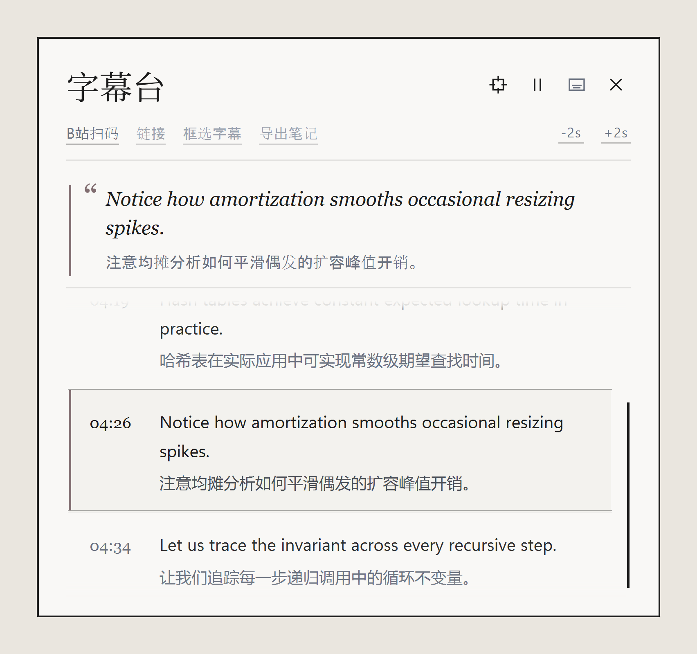
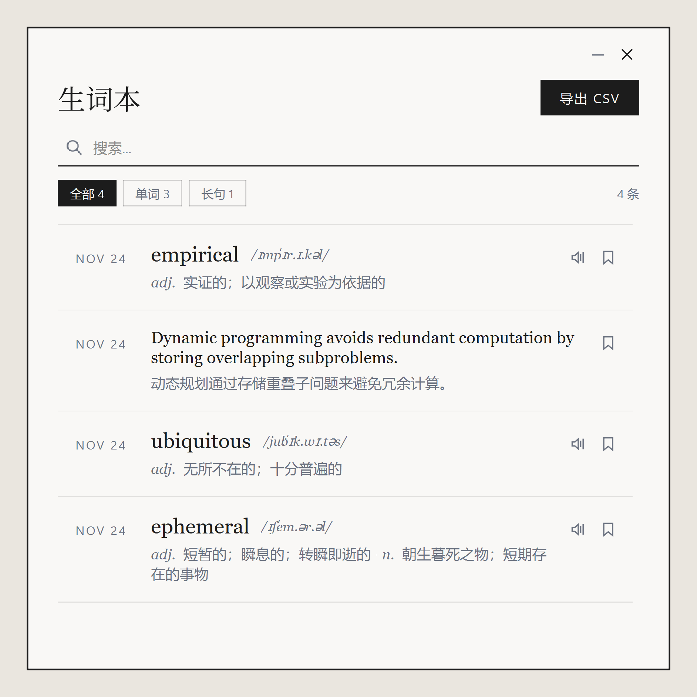
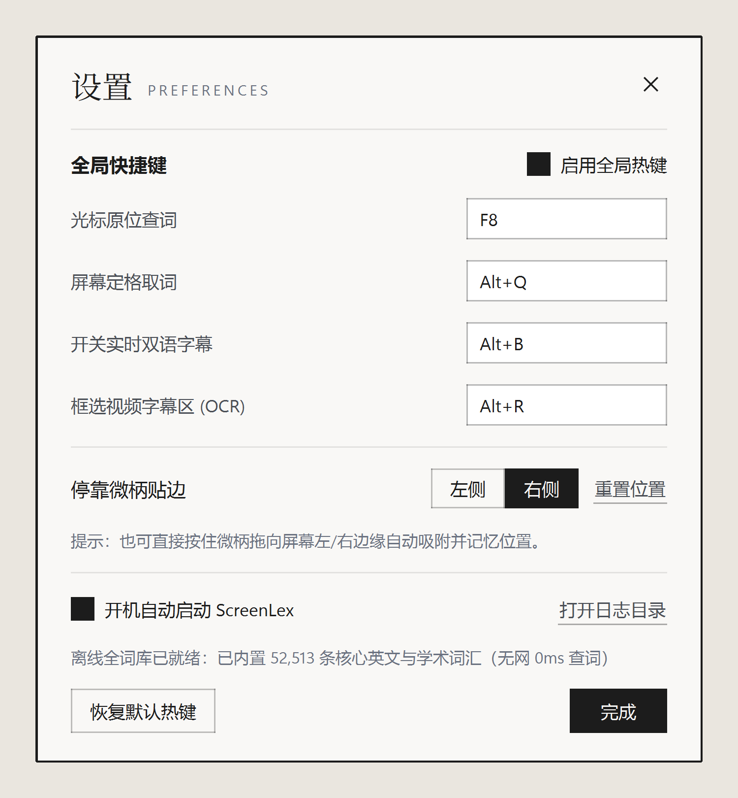

# ScreenLex

**面向 Windows 10 / 11（含触控二合一平板）的原生无感屏幕取词、52,513 词真·离线学术词典与全场景实时双语视频字幕助手。**


---

## 核心特性

### 1. 定格画面 · 多轨零延迟手势取词
- **瞬时定格选词层**：轻点屏幕左/右边缘停靠微柄或按下全局快捷键，毫秒级冻结当前屏幕并进入交互画布。
- **三轨几何手势严格解耦**：
  - **轻点单词**：0ms 命中使用预提取/按需定位词块并弹出学术词典卡片；
  - **直线横划 / 跨行拖选**：顺滑穿透行内词块或按阅读顺序连片选中长难句；
  - **闭合画圈（Lasso） / 矩形拉框**：广义卷绕数几何判定 + 自适应起笔引线/甩尾剔除，精准捕获手写笔记与排版文本。
- **指尖分流手势**：选词后下滑直接秒存生词本（不弹窗打断阅读），上滑取消，原位抬手展开词典详卡，词典原文区内还支持**二次点击/划选钻取查词**。
- **印刷体 + 手写双引擎 OCR 融合**：Windows 原生 WinRT OCR 与本地离线 RapidOCR（色彩墨迹分离 + DBNet 自适应 Padding）并发融合，兼顾 PPT 课件、PDF 论文与彩色手写板书。

### 2. 52,513 词真·离线全词库 + 联网双轨增强
- **0ms 真·离线兜底（[offline_dict.db](desktop/offline_dict.db)）**：基于 MIT 协议 ECDICT 核心词频表与内置学术语料编译的 `3.66 MB` 只读 `WITHOUT ROWID` SQLite 词库，内置 `52,513` 条常见与四六级/考研/雅思/托福/GRE 词汇，支持屈折/派生词形还原与标准 Unicode IPA 音标离线推演。
- **直连 / 活代理并行竞速**：通过 80ms TCP 系统代理探活（死代理 `<5ms` 跳过防挂起）并行竞速有道与微软 Edge 翻译通道，并在 Keep-Alive 复用前自动清理半开死链。
- **独立离线提示条与重试**：断网或超时时不再污染释义/译文主体区，改以独立 Editorial 轻量提示条显示状态并提供防连点「重试」按钮；2–3 词短语支持逐词离线参考释义（`offline_partial`）。

### 3. 全场景实时双语视频字幕（原位透视 HUD + 独立字幕台）
- **三源自动协同切换**：
  - **YouTube / Bilibili 免开 CC 外挂全片预译同步**：内置无窗 Windows UIA 浏览器探针锁相校准与 WBI / 应用内二维码扫码登录，自动抓取英文字幕轨并后台分批预译（支持 `[-2s]` / `[+2s]` 微调）；
  - **全自动屏幕字幕捕获与框选 OCR**：针对无外挂字幕的本地课程录像或 PPT 嵌视频，支持框选任意字幕区域锁定 OCR 识别，并自动缝合滚动碎词与语义断句。
- **原位透视悬浮字幕舱（HUD）**：利用 Windows `WDA_EXCLUDEFROMCAPTURE` 对截屏工具隐形，直接原位覆盖原视频单语字幕且不触发 OCR 自我循环；支持日夜双色、字号/字重调节与背景反相字色。
- **一键导出双语学习笔记**：在独立字幕台中支持每帧 40 行分批零卡顿挂载，并将整节课程一键导出为带时间轴的 **Markdown（`.md`）** 或 **TXT（`.txt`）** 双语讲稿。

### 4. Editorial 2.0 杂志美学 · 生词本与系统工程
- **生词本管理**：支持 `全部 / 单词 / 长句` 快速筛选、防抖检索、4 秒底部误删「撤销」条、每帧 40 张卡片分批挂载、以及 **Anki / CSV 一键导出**；生词数据固定持久化于 `%APPDATA%\ScreenLex\screenlex.db`。
- **全局可配置快捷键与设置中心**：可自由启用/修改 4 组全局热键并保存至 SQLite 零重启热重载，支持微柄左右吸附位置记忆、开机自启（含 Windows 11 `WS_EX_TOPMOST` Z-Order 掉层自愈守卫）与轮转日志直达。

---

## 界面预览

| Editorial 学术词典卡（支持二次划词） | 实时双语字幕台（YouTube / B站 / OCR） |
| :---: | :---: |
|  |  |

| 学术生词本（筛选 · 4 秒撤销 · 导出） | 设置中心与 52,513 词离线词库 |
| :---: | :---: |
|  |  |

---

## 快速开始

### 方式一：下载绿色便携版（推荐）
1. 前往 **[Releases](https://github.com/Gek1t/ScreenLex/releases/latest)** 下载最新的 `ScreenLex_v2.4.1_Windows_x64.zip`；
2. 解压到本地目录后，进入 `ScreenLex/` 文件夹直接双击运行 `ScreenLex.exe`；
3. 屏幕边缘出现停靠微柄、系统托盘出现图标即表示已就绪（右键微柄或托盘可打开**设置**、**生词本**、**实时双语字幕**）。

### 默认全局快捷键（可在「设置」中自定义）

| 快捷键 | 功能说明 |
| :--- | :--- |
| `F8` | 光标原位即时取词 |
| `Alt + Q` | 定格当前全屏并进入手势选词模式 |
| `Alt + B` | 开启 / 关闭实时双语视频字幕 |
| `Alt + R` | 鼠标拖拽框选视频屏幕字幕识别区 |

---

## 从源码运行与打包（Windows 10 / 11, Python 3.12+）

```powershell
# 1. 创建并激活隔离虚拟环境
python -m venv .venv
.\.venv\Scripts\Activate.ps1

# 2. 安装运行依赖（建议无头 OpenCV 以保持精简体积）
pip install -r requirements.txt

# 3. 启动桌面端主程序
python run_desktop.py
```

如需构建独立绿色可执行包（PyInstaller）：

```powershell
pip install pyinstaller
pyinstaller ScreenLex.spec --noconfirm
```

构建产物将生成于 `dist/ScreenLex/ScreenLex.exe`，用户个人生词数据库与日志始终隔离存储在 `%APPDATA%\ScreenLex\`，重新构建不会覆盖个人学习记录。

---

## 项目结构

```text
├── run_desktop.py               # 桌面端主入口（单实例互斥、ONNX/WinRT 初始化时序、异常日志）
├── ScreenLex.spec               # PyInstaller 发行打包配置
├── requirements.txt             # Windows 运行时依赖清单
├── CHANGELOG.md                 # 全版本更新日志（当前最新 v2.4.1）
├── AGENTS.md                    # 架构约束与 Windows/Qt 踩坑规范（§§1-23）
├── docs/screenshots/            # 界面截图资产
└── desktop/
    ├── app.py                   # 全局协调器、托盘、热键调度、开机自启与窗口生命周期
    ├── input_hook.py            # Windows 低延迟全局快捷键与触控手势钩子引擎
    ├── freeze_overlay.py        # 定格选词画布（圈选 / 拉框 / 划线 / 大括号多轨几何）
    ├── win_ocr.py               # WinRT OCR + 本地离线 RapidOCR 混合手写/字幕识别管线
    ├── ocr_helpers.py           # 物理行聚类、连字符重组、粘连拆词与数学符号保护
    ├── offline_dict.py          # 52k 只读 SQLite 离线词库查询引擎
    ├── offline_dict.db          # 预编译离线全词库（3.66 MB）
    ├── common_words.txt         # 英文高频词频表
    ├── dictionary_service.py    # 本地极速查词、直连/活代理并行竞速翻译、音标推演与 TTS
    ├── grammar_checker.py       # 学术拼写纠错、构词法保护与语境润色引擎
    ├── dictionary_window.py     # Editorial 学术词典卡（二次划词、独立离线提示条与重试）
    ├── floating_dock.py         # 屏幕左/右吸附停靠微柄与 Z-Order 置顶守卫
    ├── subtitle_engine.py       # 实时双语字幕捕获、YouTube/B站字幕轨同步、UIA 锁相与滚动缝合
    ├── subtitle_window.py       # 原位透视 HUD / 独立双语字幕台 / Markdown & TXT 讲稿导出
    ├── vault_window.py          # 生词本（筛选、4 秒撤销、分批挂载、Anki/CSV 导出）
    ├── settings_window.py       # 独立 Editorial 设置中心
    ├── database.py              # SQLite 生词与配置持久化层（%APPDATA%\ScreenLex\screenlex.db）
    ├── ui_icons.py              # 矢量图标、Win11 DWM 原生边框与 64 位 Z-Order 工具集
    └── logger.py                # 线程安全 UTF-8 轮转日志
```

---

## 更新日志与致谢

- 详细版本变更请参阅 **[CHANGELOG.md](CHANGELOG.md)**。
- 离线词库编译自 MIT 协议开源项目 [skywind3000/ECDICT](https://github.com/skywind3000/ECDICT) 与学术语料；本地 OCR 能力依托 [RapidOCR](https://github.com/RapidAI/RapidOCR) 与 Windows Runtime OCR，GUI 基于 [PySide6](https://doc.qt.io/qtforpython-6/)。

## License

本项目采用 **[MIT License](LICENSE)** 开源。
